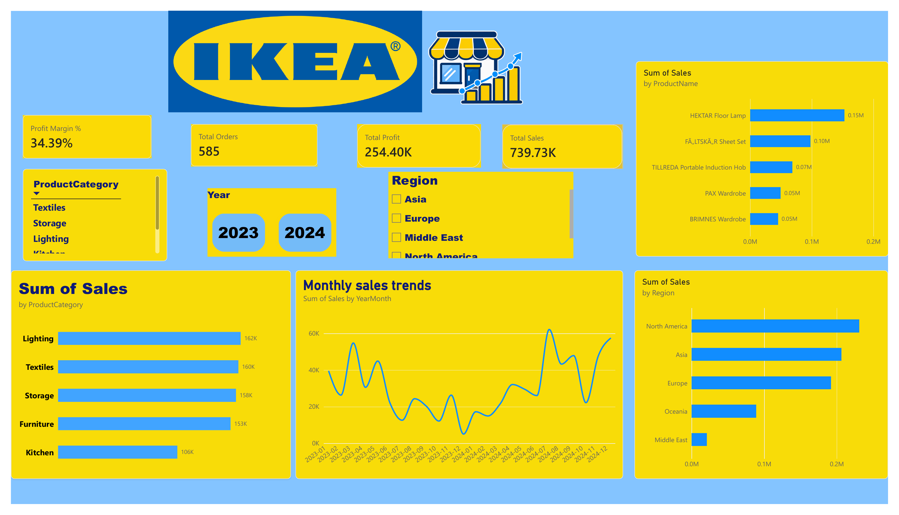

# IKEA Retail Sales Analysis

A data analysis project exploring IKEA retail sales with Python, MySQL, and Power BI. The project covers data validation, sales analysis, and an interactive dashboard for reviewing key sales indicators and trends.

## Project goals

- Prepare the sales data for analysis and check its quality.
- Explore sales across product categories, regions, and time periods.
- Present key indicators and trends in an interactive Power BI dashboard.

## Tools

- Python and Pandas
- MySQL
- Power BI and DAX

## Project files

- `IKEA_data_analysis.ipynb` — Python data preparation and analysis.
- `Ikea_project's_query.sql` — SQL queries used for sales analysis.
- `Ikea_powerBI.pbix` — Power BI report file.
- `IKEA_dashboard.png` — dashboard preview.

## Analysis overview

The notebook validates 585 sales records across 37 columns using Python and Pandas. SQL analysis compares sales by category, region, and time period. The Power BI report presents the results with KPI cards, measures, and interactive filters.

## Dashboard preview

## How to view

1. Open the notebook in Jupyter Notebook or JupyterLab.
2. Run the SQL queries in MySQL with the project dataset available.
3. Open `Ikea_powerBI.pbix` in Power BI Desktop to explore the report.

## Note

The dashboard image is included as a quick preview. Use the PBIX file for interactive exploration.
